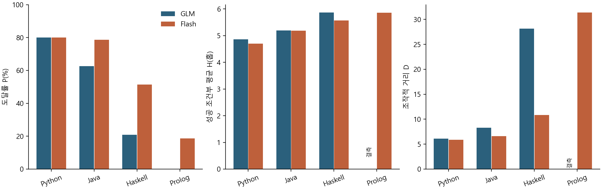
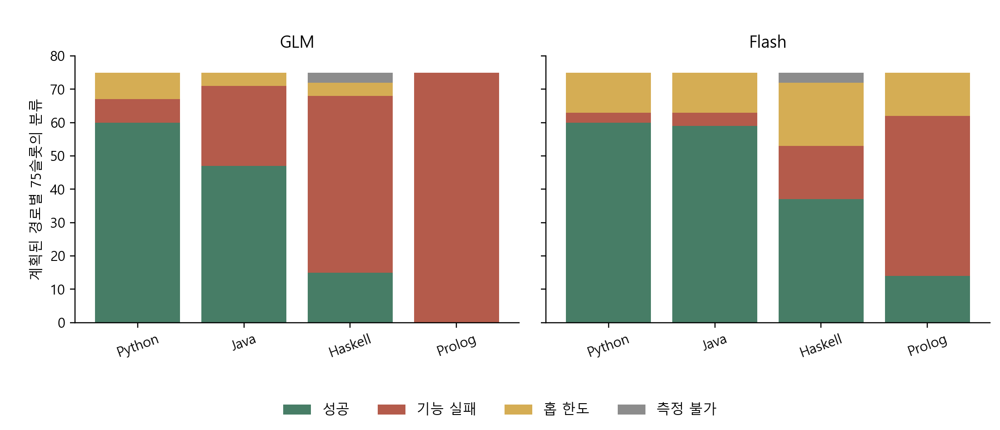

# 프로그래밍 언어 간 의미 거리의 정량적 측정 방법

왕복 번역의 도달률·안정성·실패 양상에 대한 v1.6 실증 분석

한상곤, 우균(교신저자)

부산대학교 대학원 정보융합공학과

연락처: {sangkon, woogyun}@pusan.ac.kr

## 요약

대규모 언어 모델을 이용한 코드 변환에서 번역 결과의 기능 보존과 반복 번역의 구조적 안정성은 서로 다른 평가 대상입니다. 본 연구는 C++ 프로그램을 다른 언어로 변환한 뒤 C++로 복원하는 왕복 번역을 반복하고, 기능 검사를 통과하면서 인접 복원 코드의 유사도가 임계치에 처음 도달하는 과정을 분석합니다. 최초 도달률 P, 성공한 시도의 평균 편도 홉 수 H, 조작적 거리 D=H/P를 사용하였습니다. 15개 알고리즘 문제에 대해 Python·Java·Haskell·Prolog 경유 경로를 문제당 5회 반복하여 GLM-5.3와 DeepSeek v4.1 Flash에서 각각 300슬롯을 수집하였습니다. 주 임계치 0.85에서 GLM의 도달률은 경로 순서대로 80.0%, 62.7%, 20.8%, 0.0%였고, Flash에서는 80.0%, 78.7%, 51.4%, 18.7%였습니다. Haskell의 각 3슬롯은 유사도 측정 불가로 유효 분모에서 제외되었습니다. Flash의 D는 각각 5.875, 6.593, 10.834, 31.378이었으며, GLM Prolog는 성공이 없어 H·D를 산출하지 않았습니다. Flash의 Python·Java 미도달은 주로 홉 한도와 연결된 반면 Prolog에서는 기능 실패가 우세하였습니다. 최초 성공 뒤 추가 왕복에서 기준을 유지한 비율은 Flash에서 28.6~51.7%로, 단일 임계치 도달을 지속적인 고정점으로 해석하기 어려웠습니다. 재귀 구현군의 Haskell 도달률도 모델별로 상반된 양상을 보였습니다. 따라서 거리 지수는 언어 자체의 불변 특성보다 모델·문제·평가 조건이 결합된 왕복 경로의 변환 부담으로 해석합니다. 측정 불가와 통신 사고의 감사 결과로 두 캠페인 모두 사전 지정된 확증 분석의 완전성을 충족하지 못하였으므로, 경로 순위와 모델 차이는 기술통계 범위에서 논의합니다.

주제어: 왕복 번역, 근사 고정점, 코드 번역, 기능 검사, 구조 유사도, 조작적 거리

## 1. 서론

서로 다른 프로그래밍 언어 사이의 코드 변환은 같은 알고리즘을 다른 표현 체계에서 다시 구성하는 작업입니다. 반복문과 가변 배열을 중심으로 작성한 프로그램을 재귀·불변 자료구조 또는 논리적 관계로 표현할 때는 제어 흐름과 상태 관리의 대응을 고려해야 합니다. 그러나 변환 과정에서 관찰되는 어려움이 언어의 차이에서 비롯되는지, 번역 모델의 생성 능력이나 평가 환경에서 비롯되는지를 구분하기는 쉽지 않습니다. 따라서 언어 사이의 거리를 논의하려면 하나의 최종 점수와 함께 그 점수를 만든 성공·실패 과정도 제시할 필요가 있습니다.

코드 번역 연구에서는 C++·Java·Python 사이의 번역 결과를 실행 가능한 테스트로 평가한 접근이 제시되었습니다[2]. 다언어 코드 생성 평가인 MultiPL-E도 언어를 확장할 때 공통 문제와 테스트를 구성하는 방법을 다룹니다[4]. 이들 연구는 실행 결과를 통한 검증이 코드 변환 평가에서 중요한 근거라는 점을 보여줍니다. 다만 한 번의 코드 생성이나 번역 성공만으로 반복 변환 뒤의 구조적 안정성까지 알 수는 없습니다.

왕복 번역(round-trip translation, rtt)은 원래 표현을 다른 표현으로 변환한 뒤 다시 복원하는 절차입니다. 조찬우 등의 선행 연구는 자연어의 왕복 번역과 고정점 개념을 언어 거리 분석에 적용하였습니다[1]. Allamanis 등은 코드 생성·편집 모델 평가에서 왕복 정확성(round-trip correctness, rtc)을 제안하였습니다[3]. 본 연구는 이러한 왕복 관점을 프로그램 변환에 적용하되, 각 방향의 기능 검사와 복원 코드 사이의 구조 유사도를 구분하고 최초 도달 이후의 유지 여부까지 관찰합니다. 확률적인 번역 절차의 한 번의 도달은 수학적 수렴 증명과 구별합니다.

v1.5 원고는 평균 홉 수를 성공률로 보정하는 지표를 통해 경로 사이의 차이를 설명하였습니다. v1.6에서는 이 기본 구성을 유지하면서 실제 동결 계약·원관측·측정 실패·통신 사고의 감사 근거에 맞추어 해석을 확장합니다. 특히 성공이 없는 경로의 거리, 측정 불가 슬롯의 분모, 최초 도달과 다음 왕복의 유지, 재귀 문제군의 차이를 명시적으로 다룹니다. 문제 일부와 중단 규칙이 바뀌었으므로 v1.5의 결과를 v1.6에 합산하거나 판본 간 개선율로 환산하지 않습니다.

본 연구는 다음 세 질문을 다룹니다. 첫째, 같은 기준 언어에서 출발한 네 경유 경로의 도달률과 성공 조건부 홉 수는 어떻게 다릅니까? 둘째, 경로별 차이는 기능 손실, 구조적 비도달, 측정 불가 중 어느 양상과 연결됩니까? 셋째, 임계치와 문제 구현 특성, 번역 모델이 달라질 때 이러한 차이는 어느 범위까지 유지됩니까? 이 질문에 답하기 위해 GLM-5.3와 DeepSeek v4.1 Flash의 독립 캠페인을 분석합니다. 본 연구의 기여는 하나의 패러다임 순위를 확정하기보다, 거리 지표를 구성하는 관측을 분해하고 그 해석이 가능한 범위를 실험 자료로 제시하는 데 있습니다.

## 2. 연구 방법론 및 실험 설계

### 2.1 왕복 번역과 최초 도달의 정의

기준 C++ 프로그램을 C₀, 대상 언어를 L이라고 하겠습니다. 한 번의 왕복은 Cₖ₋₁을 L의 프로그램 Bₖ로 변환하는 정방향 1홉과 Bₖ를 C++ 프로그램 Cₖ로 복원하는 역방향 1홉으로 구성됩니다. 각 단계는 직전의 실제 생성 코드를 입력으로 사용합니다. 기능적으로 실패한 결과를 수정하여 다시 생성하거나 다른 응답으로 대체하지 않습니다.

왕복 k의 인접 유사도는 Sₖ=JPlag(Cₖ₋₁,Cₖ)로 정의합니다. 첫 왕복에서는 C₀와 C₁을 비교하므로 최초 도달은 2홉에서도 가능합니다. 해당 시점까지 정방향과 역방향의 기능 검사를 모두 통과하고 Sₖ≥θ이면 그 임계치의 최초 도달로 기록합니다. 이는 주어진 검사를 통과하면서 두 연속 C++ 표현의 유사도가 높은 상태를 의미합니다. 모든 입력에 대한 의미 동등성이나 이후 모든 왕복에서의 불변성을 의미하지 않습니다.

주 임계치는 θ=0.85이고 0.80과 0.90을 같은 번역 궤적에서 함께 기록합니다. 어느 임계치에서 먼저 성공했는지와 이후 높은 임계치에 도달하는지는 별도 결과입니다. 예를 들어 0.80에 도달한 뒤 기능 오류가 발생하면 0.80의 최초 성공은 보존하고, 아직 도달하지 못한 더 높은 임계치에는 해당 실패를 기록합니다. 따라서 마지막 중단 상태와 임계치별 성공·실패 분류는 반드시 같지는 않습니다.

### 2.2 도달률·평균 홉 수·조작적 거리

한 경로에서 판단 가능한 유효 슬롯 수를 n, 최초 도달 성공 수를 s, 성공 i의 최초 편도 도달 홉을 hᵢ라고 할 때 지표를 다음과 같이 정의합니다.

P=s/n,　H=(Σᵢ₌₁ˢ hᵢ)/s,　D=H/P.

P의 분모에는 기능 실패와 홉 한도 도달을 포함하고 판정할 수 없는 무효·미완료는 제외합니다. H는 성공한 시도만의 조건부 평균이며 고유 소스 상태의 수나 전체 API 호출 수가 아닙니다. s=0이면 P=0이고 H·D는 결측입니다. 이를 임의의 큰 값이나 관측된 무한대로 바꾸지 않습니다.

D는 도달률이 낮아지거나 성공까지의 홉 수가 길어지면 커지는 조작적 지수입니다. 성공한 소수의 쉬운 사례만으로 H가 작게 보일 수 있다는 점을 보완하지만, 모든 실패의 실행 비용을 직접 더한 값은 아닙니다. 실패한 시도의 비용 분포를 사용하지 않았으므로 D를 성공 한 건에 필요한 실제 기대 호출 수로 해석하지 않습니다. 본 실험은 기준 언어를 C++로 고정했으므로 거리의 대칭성·삼각부등식을 검증하지 않았습니다. 이하의 ‘의미 거리’는 이 조건부 측정 절차의 명칭으로 사용합니다.

### 2.3 문제 구성과 기준 구현 검증

백준 계열과 LeetCode에서 구성한 15개 알고리즘 문제를 사용합니다. 기준 C++ 구현의 성격에 따라 하노이탑·쿼드트리·N-Queen을 사전 지정 재귀군으로, 나머지 12문제를 비교군으로 분류하였습니다. 이 분류는 문제를 풀 수 있는 모든 구현이 아니라 실제 기준 C++ 구현을 대상으로 합니다. 최대공약수·최소공배수 문제는 재귀적으로도 풀 수 있지만 본 코퍼스의 C++는 while 기반 유클리드 구현이므로 비교군에 속합니다.

표 1. v1.6의 문제 구성과 실제 기준 구현의 성격

<!-- 표:문제 -->
| 문제 | 내용 | 기준 C++ 구현 특성 |
| --- | --- | --- |
| IPOP_11729 | 하노이탑 이동 순서 | 다중 재귀·이동 순서 출력 |
| IPOP_2110 | 공유기 설치 | 반복 이분탐색·탐욕 배치 |
| IPOP_1992 | 쿼드트리 | 사분면 재귀·결과 결합 |
| IPOP_2579 | 계단 오르기 | 배열 기반 동적 계획법 |
| IPOP_5567 | 결혼식 | 깊이 제한 그래프 탐색 |
| IPOP_10988 | 팰린드롬인지 확인하기 | 문자열 대칭 비교 |
| IPOP_1929 | 소수 구하기 | 반복·소수의 체 |
| IPOP_2609 | 최대공약수와 최소공배수 | 반복 유클리드 알고리즘 |
| IPOP_9012 | 괄호 | 순차 괄호 균형 검사 |
| LC_0053 | Maximum Subarray | 반복·최대 부분배열 갱신 |
| LC_0062 | Unique Paths | 격자 경로 동적 계획법 |
| IPOP_9663 | N-Queen | 재귀·되추적·가변 상태 복원 |
| LC_0242 | Valid Anagram | 문자 빈도 집계 |
| LC_0283 | Move Zeroes | 배열 원소 이동·상태 갱신 |
| LC_0338 | Counting Bits | 비트 수 동적 계획법 |
<!-- /표:문제 -->

문제당 13쌍의 평가 입력·정답을 공통으로 사용합니다. 본 실험 전 15문제×5언어의 75개 기준 구현에 대한 975개 실행 검사가 통과하였습니다. 별도의 계산 방식으로 정답을 대조한 195개 입력 검증은 이 975개 언어별 실행 수에 중복 합산하지 않습니다. 이후 모든 생성 프로그램에도 같은 13개 평가를 적용합니다. 컴파일 한도는 180초, 각 평가 입력의 실행 한도는 5초입니다. 이 검증은 준비한 입력에서의 기능 보존 근거이며 평가 입력에 포함되지 않은 모든 경우의 정확성을 보장하지 않습니다.

### 2.4 모델 설정과 독립 캠페인

각 모델에서 15문제×4경로×5반복으로 300슬롯을 계획하고 모두 저장하였습니다. 별도 파일럿은 지정된 3문제×4경로×1반복의 12슬롯으로 본 실험의 성공 수와 합산하지 않습니다. 일정 시드는 20261117로 유지하였습니다. 이는 문제·경로의 실행 순서를 정하는 시드이며 모델의 출력 생성 시드와 구별합니다.

표 2. 실제 요청에 사용한 모델별 설정

| 항목 | GLM-5.3 | DeepSeek v4.1 Flash |
| --- | --- | --- |
| 요청·정상응답 모델 ID | zai-org/GLM-5.3 | deepseek/deepseek-v4.1-flash |
| 공급 경로 | Command Code 채팅 API | Command Code 채팅 API |
| 본 실험 수집일 | 2026-11-17 | 2026-11-18 |
| max_tokens | 16384 | 16384 |
| reasoning_effort | low | low |
| temperature | 0.6 요청 | 요청하지 않음 |
| top_p | 0.95 요청 | 요청하지 않음 |
| 모델 생성 seed | 요청하지 않음 | 요청하지 않음 |
| 서버 실효 설정 | 미보고 | 미보고 |

Flash는 기존 실험 조건과 공식 추론 모드 제약을 고려하여 temperature를 보내지 않았으며 top_p도 추가하지 않았습니다. Flash에서 top_p가 지원되지 않는다는 뜻은 아닙니다[7]. 따라서 두 캠페인을 동일한 생성 파라미터의 모델 교체 실험으로 표현하지 않습니다. 같은 low도 동일한 실효 추론량을 보장하지 않습니다. 모델 간 수치 비교는 이 요청 조건과 수집 시점이 결합된 관측 비교입니다.

DeepSeek v4 Pro의 두 중단 실행은 별도 캠페인입니다. 각각 저장된 4슬롯과 11슬롯은 HTTP 524 사고·중단 근거와 함께 보존하였고 Flash의 300슬롯에 가져오거나 부족한 결과를 채우는 데 사용하지 않았습니다. 이를 합산한 모델 성능도 계산하지 않습니다.

### 2.5 구조 유사도·확인 왕복·중단 규칙

구조 유사도는 JPlag 6.3.0의 C++ 비교와 averageSimilarity를 사용합니다. 최소 매칭 토큰은 9이고 별도 정규화 옵션은 사용하지 않았습니다. JPlag는 소스를 토큰화하여 구조적인 공통 부분을 비교하는 도구이며[5,6], 본 연구에서는 실제 측정이 이루어진 경우의 점수만 사용합니다. 측정 실패를 유사도 0으로 채우지 않습니다.

탐색은 최대 편도 10홉과 900초로 제한합니다. 주 임계치의 최초 성공 뒤에는 다음 왕복 1회를 확인 대상으로 지정하며 확인 시간 한도는 300초입니다. 높은 임계치의 탐색이 계속되는 동안 이 다음 왕복이 수행될 수 있고 주 임계치가 10홉에서 처음 도달한 경우에는 확인용 2홉이 추가될 수 있습니다. 확인 결과는 최초 성공을 소급하여 지우지 않습니다. 따라서 최초 도달률과 확인 유지율을 별도로 보고합니다.

컴파일·실행·정답·응답 형식의 기능 판정 실패, 10홉까지의 임계치 미도달, 유사도 측정 불가·통신 결과 불명 등의 무효를 구분합니다. 홉 한도는 제한된 구간에서 기준에 도달하지 않았다는 뜻이며 번역을 무한히 반복해도 수렴하지 않는다는 판정이 아닙니다. 시간·관측 제한도 계산 가능한 코드의 의미 오류와 구별합니다.

### 2.6 통계와 감사 원칙

같은 문제에서 반복한 다섯 시도와 서로 다른 경로는 독립적인 새 문제 75개로 취급하지 않습니다. 사전 계획은 15개 문제를 블록으로 10,000회 재표집하고 주 임계치의 6개 경로 쌍×3지표에 대한 Bonferroni 18비교 구간으로 전체 순위를 확인하는 방식이었습니다. 그러나 두 캠페인 모두 측정 불가로 임계치별 완전성 조건을 충족하지 못하였습니다. 공식 산출물의 실제 구간은 미보정 95% 기술 구간이며 사전 계획된 확증 구간으로 제시하지 않습니다. 성공 0인 재표집 표본 때문에 H·D가 정의되지 않으면 결측 비율과 구간 산출 불가를 유지합니다.

본문의 주 결과표는 두 모델에서 같은 공식 원관측의 유효 분모 정의를 적용합니다. GLM의 HTTP 524 감사가 영향을 주는 0.90 및 확인 결과는 감사 후 값을 명시합니다. 기존 사용자 요청에 따라 GLM 측정 불가 3건을 별도 측정 실패로 분모에 편입한 사후 집계도 병기합니다. 이 사후 규칙을 Flash의 동결 판정에 적용하거나 과거 계약의 완전성 판정을 덮어쓰지 않습니다.

## 3. 실험 결과 및 해석

### 3.1 주 임계치에서의 경로별 차이

표 3은 θ=0.85의 최초 도달 결과입니다. 두 모델 모두 경로당 75슬롯을 저장했으나 Haskell에서는 각각 3개 측정 불가를 제외하여 유효 분모가 72입니다. GLM의 Python은 60/75, Java는 47/75, Haskell은 15/72였으며 Prolog에서는 75회 중 최초 성공이 없었습니다. Flash에서는 각각 60/75, 59/75, 37/72, 14/75였습니다.

표 3. 주 임계치 0.85의 공식 원관측 기술통계

<!-- 표:주결과 -->
| 모델 | 경로 | 성공/유효 | P(%) | H(홉) | D |
| --- | --- | --- | --- | --- | --- |
| GLM | Python | 60/75 | 80.0 | 4.867 | 6.083 |
| GLM | Java | 47/75 | 62.7 | 5.191 | 8.284 |
| GLM | Haskell | 15/72 | 20.8 | 5.867 | 28.160 |
| GLM | Prolog | 0/75 | 0.0 | — | — |
| Flash | Python | 60/75 | 80.0 | 4.700 | 5.875 |
| Flash | Java | 59/75 | 78.7 | 5.186 | 6.593 |
| Flash | Haskell | 37/72 | 51.4 | 5.568 | 10.834 |
| Flash | Prolog | 14/75 | 18.7 | 5.857 | 31.378 |
<!-- /표:주결과 -->

그림 1. θ=0.85의 P·H·D를 분리한 비교입니다. GLM Prolog의 H·D는 성공 0건에 따른 결측이며 0으로 대체하지 않았습니다. 그래프는 기술통계이고 확증적 순위를 표시하지 않습니다.

Flash에서 계산 가능한 D의 점추정치는 Python<Java<Haskell<Prolog입니다. 다만 Python과 Java의 P 차이는 1.3%p에 불과하며 해당 D 차이의 미보정 95% 기술 구간은 −2.523~1.224로 0을 포함합니다. 따라서 두 경로의 순서를 통계적으로 확정하기 어렵습니다. GLM에서도 계산 가능한 세 경로의 점추정치는 Python<Java<Haskell이지만 Prolog의 위치를 유한한 D로 정렬할 수는 없습니다. 성공이 없다는 관측은 본 조건에서의 낮은 도달 가능성을 드러내지만 언어 고유의 무한 거리나 계산 불가능성을 입증하지는 않습니다.

P가 같은 결과도 H에 따라 D가 달라집니다. Python은 두 모델 모두 60/75로 도달률이 같지만 H가 GLM 4.867, Flash 4.700이므로 D가 각각 6.083과 5.875입니다. Haskell에서는 H가 5.867에서 5.568로 약간 달라지는 동안 P는 20.8%에서 51.4%로 크게 달라집니다. 따라서 관측 D의 28.160 대 10.834 차이는 주로 성공할 수 있었던 시도의 비중과 연결됩니다. 이를 모델 변경만의 인과 효과나 언어 자체의 거리가 감소한 것으로 해석하지 않습니다.

### 3.2 미도달의 원인은 경로마다 다릅니다

표 4는 각 경로의 저장된 75슬롯을 주 임계치의 상호 배타적인 범주로 나눈 결과입니다. 기능 실패와 홉 한도를 합쳐 하나의 실패율로만 표시하면 실제 병목을 놓칠 수 있습니다.

표 4. 주 임계치의 결과 분포

<!-- 표:분류 -->
| 모델 | 경로 | 성공 | 기능 실패 | 홉 한도 | 측정 불가 무효 |
| --- | --- | --- | --- | --- | --- |
| GLM | Python | 60 | 7 | 8 | 0 |
| GLM | Java | 47 | 24 | 4 | 0 |
| GLM | Haskell | 15 | 53 | 4 | 3 |
| GLM | Prolog | 0 | 75 | 0 | 0 |
| Flash | Python | 60 | 3 | 12 | 0 |
| Flash | Java | 59 | 4 | 12 | 0 |
| Flash | Haskell | 37 | 16 | 19 | 3 |
| Flash | Prolog | 14 | 48 | 13 | 0 |
<!-- /표:분류 -->

그림 2. 경로별 75슬롯의 실제 분류입니다. 측정 불가를 기능 실패에 합산하지 않았으며 최초 성공 뒤 확인 실패가 발생한 경우에도 이미 달성한 최초 성공은 보존하였습니다.

Flash의 Python·Java에서는 각각 미도달 15건과 16건 중 12건이 홉 한도였습니다. 이는 두 경로에서 기능 검사를 통과하는 변환이 가능하더라도 정해진 탐색 구간 안에서 구조 유사도가 기준에 도달하지 않는 경우가 상당했음을 뜻합니다. Python의 주 임계치 기능 실패 3건은 시간 초과였고 Java의 4건은 런타임 오류 3건과 오답 1건이었습니다. Python의 세 시간 초과가 재귀군에 속한다는 점도 전체 경로의 일반적 코드 생성 실패와 문제별 자원 부담을 구분하게 합니다.

Flash의 Haskell에서는 기능 실패 16건보다 홉 한도 19건이 조금 많았습니다. 기능 실패 중 13건은 컴파일 오류였으며 런타임 오류 1건과 오답 2건이 뒤따랐습니다. 따라서 이 경로는 컴파일 가능한 대상 코드를 만드는 문제와 기능이 유지된 코드 사이에서 구조적 기준에 도달하는 문제가 함께 나타납니다. 컴파일 오류라는 분류만으로 구체적인 타입 추론이나 상태 변환이 원인이라고 단정할 수는 없으며 그 설명은 개별 코드·진단 메시지의 추가 분석을 필요로 합니다.

Flash의 Prolog에서는 미도달 61건 중 기능 실패가 48건으로 78.7%를 차지했습니다. 기능 실패의 세부 분류는 런타임 오류 33건, 오답 8건, 시간 초과 5건, 컴파일 오류 2건입니다. 이 경로에서는 높은 구조 유사도에 도달하기 전 프로그램을 기능적으로 유지하는 문제가 우세하였습니다. GLM Prolog는 75건 모두 주 임계치 도달 전 기능 실패로 끝났습니다. 다만 이 사실만으로 논리형 패러다임 자체가 본질적으로 열등하다고 결론 내릴 수는 없습니다. 사용한 모델의 언어별 출력, 프롬프트, 런타임, 입출력 관례를 함께 통과해야 하는 경로 전체의 결과이기 때문입니다.

두 캠페인을 전체 건수로 보면 주 임계치 성공은 GLM 122건, Flash 170건이고 기능 실패는 각각 159건과 71건입니다. 동시에 홉 한도도 16건에서 56건으로 많아졌습니다. 이 구성 차이는 기능 오류로 조기에 끝나던 일부 유형의 궤적이 기능을 유지하며 더 오래 관측될 수 있는 상황과 부합합니다. 그러나 서로 다른 캠페인의 동일 반복 번호를 같은 확률적 궤적의 전후로 대응시킬 수는 없으므로 개별 실패가 다른 범주로 ‘전환되었다’고 주장하지 않습니다.

### 3.3 성공 조건부 평균과 방향별 생존 선택

GLM에서 H는 Python 4.867홉, Java 5.191홉, Haskell 5.867홉으로 차이가 1홉 정도인데 P의 차이는 훨씬 큽니다. Flash에서도 H의 범위는 4.700~5.857홉인 반면 P는 18.7~80.0%입니다. 성공한 시도의 평균만 비교하면 도달하기 전에 탈락한 다수의 시도를 보지 못하게 됩니다. 이 점에서 P와 H를 함께 제시할 필요가 있습니다.

표 5는 이 선택 과정을 첫 왕복의 정·역방향으로 보여줍니다. 역방향 분모는 정방향을 이미 통과한 결과이므로 두 방향의 통과율은 같은 모집단의 독립 비교가 아닙니다.

표 5. 첫 왕복에서의 기능 검사 통과 수

<!-- 표:첫왕복 -->
| 모델 | 경로 | 정방향 기능 통과 | 역방향 기능 통과(조건부) |
| --- | --- | --- | --- |
| GLM | Python | 70/75 | 70/70 |
| GLM | Java | 56/75 | 55/56 |
| GLM | Haskell | 46/75 | 46/46 |
| GLM | Prolog | 14/75 | 14/14 |
| Flash | Python | 73/75 | 73/73 |
| Flash | Java | 72/75 | 72/72 |
| Flash | Haskell | 71/75 | 70/71 |
| Flash | Prolog | 50/75 | 50/50 |
<!-- /표:첫왕복 -->

GLM Prolog의 정방향은 14/75만 통과했지만 이어진 역방향은 14/14가 통과했습니다. Flash Prolog도 정방향 50/75 뒤 역방향 50/50이 통과했습니다. 이 100%는 모든 Prolog 프로그램을 C++로 쉽게 변환할 수 있다는 뜻이 아닙니다. 직전 번역과 기능 검사를 통과한 표본만 남았다는 조건을 포함합니다. 뒤쪽 홉의 통과율이 높더라도 처음 75개 시도의 전체 생존율이 높아졌다고 볼 수 없습니다.

D는 이처럼 성공한 표본만으로 계산되는 H를 P로 보정합니다. 그러나 성공 0건인 GLM Prolog에서는 보정할 H 자체가 없습니다. 결과표에서 이 경우를 결측으로 남기는 것은 지표의 적용 한계를 숨기지 않는 처리입니다. 경로별 측정치를 해석할 때에는 D 순위와 함께 P, 성공 표본 수, 기능 실패 및 홉 한도를 동시에 확인해야 합니다.

### 3.4 최초 도달은 다음 왕복의 유지와 다릅니다

표 6은 주 임계치에서 최초 성공한 시도만을 대상으로 다음 1왕복을 확인한 결과입니다. 유지율은 유지/(유지+실패)이며 확인 불가는 분모에서 제외하되 건수를 함께 제시합니다. GLM Haskell은 HTTP 524 감사 후 결과 불명 1건을 확인 실패에서 확인 불가로 옮긴 5/14를 사용합니다.

표 6. 최초 성공 이후 다음 왕복의 확인 결과

<!-- 표:확인 -->
| 모델 | 경로 | 최초 성공 | 유지 | 실패 | 확인 불가 | 유지율(%) |
| --- | --- | --- | --- | --- | --- | --- |
| GLM | Python | 60 | 30 | 29 | 1 | 50.8 |
| GLM | Java | 47 | 20 | 27 | 0 | 42.6 |
| GLM | Haskell | 15 | 5 | 9 | 1 | 35.7 |
| GLM | Prolog | 0 | 0 | 0 | 0 | — |
| Flash | Python | 60 | 31 | 29 | 0 | 51.7 |
| Flash | Java | 59 | 28 | 31 | 0 | 47.5 |
| Flash | Haskell | 37 | 12 | 23 | 2 | 34.3 |
| Flash | Prolog | 14 | 4 | 10 | 0 | 28.6 |
<!-- /표:확인 -->

Flash에서는 최초 성공 170건 중 확인 유지 75건, 확인 실패 93건, 확인 불가 2건이었습니다. 판단 가능한 168건의 유지율은 44.6%입니다. Python과 Java에서도 유지율은 각각 51.7%와 47.5%로 절반 안팎이었습니다. Haskell은 34.3%, Prolog는 28.6%였습니다. GLM의 판단 가능한 확인 120건 중 유지는 55건으로 45.8%였습니다. 이 전체 유지율은 성공 경로의 구성비가 다르므로 모델 간 우열을 판단하는 공통 난도의 점수로 사용하지 않습니다.

이 결과는 ‘처음 임계치를 넘었다’는 사건과 ‘이후에도 그 상태가 유지된다’는 주장이 다르다는 점을 보여줍니다. 확률적 번역 과정에서는 비슷한 C++ 표현을 연속해서 생성한 뒤 다음 번역에서 다른 구조를 선택할 수 있습니다. 확인 실패에는 기능 오류나 유사도 미달이 포함될 수 있어 원인별 구분도 필요합니다. 한 번의 확인 통과 역시 무한 반복의 고정점을 증명하지는 않습니다.

예를 들어 Flash Python의 최초 성공은 60/75지만 다음 왕복까지 실제 확인된 유지는 31/75입니다. 두 값은 각각 다른 사건의 빈도입니다. 본 연구의 D는 최초 도달 정의를 유지하며 확인 통과 수로 P를 사후 교체하지 않습니다. 이 구분을 통해 최초 도달을 과대해석하지 않으면서도 정해진 지표의 정의를 보존할 수 있습니다.

### 3.5 임계치 민감도와 근접 경로의 순서 변화

표 7은 같은 궤적에서 임계치 0.80·0.85·0.90을 달리했을 때의 P와 D입니다. GLM의 0.90 Haskell은 HTTP 524 이후 결과를 제외한 감사 후 13/71이며 그 외 주 결과의 공식 원관측과 차이가 없는 값도 함께 사용하였습니다. 이는 별도 임계치마다 독립 실험을 새로 수행한 결과가 아닙니다.

표 7. 임계치 민감도 기술통계

<!-- 표:민감도 -->
| 모델 | 경로 | P: 0.80→0.85→0.90(%) | D: 0.80→0.85→0.90 |
| --- | --- | --- | --- |
| GLM | Python | 81.3 → 80.0 → 78.7 | 5.765 → 6.083 → 6.205 |
| GLM | Java | 65.3 → 62.7 → 62.7 | 7.372 → 8.284 → 8.624 |
| GLM | Haskell | 22.2 → 20.8 → 18.3 | 25.875 → 28.160 → 31.089 |
| GLM | Prolog | 0.0 → 0.0 → 0.0 | — → — → — |
| Flash | Python | 84.0 → 80.0 → 78.7 | 5.782 → 5.875 → 6.334 |
| Flash | Java | 82.7 → 78.7 → 74.7 | 5.502 → 6.593 → 7.557 |
| Flash | Haskell | 56.9 → 51.4 → 45.8 | 9.594 → 10.834 → 13.091 |
| Flash | Prolog | 20.0 → 18.7 → 16.0 | 28.000 → 31.378 → 36.458 |
<!-- /표:민감도 -->

Flash에서 임계치가 0.80에서 0.90으로 높아질 때 성공 수는 Python 63→59, Java 62→56, Haskell 41→33, Prolog 15→12로 줄었습니다. Haskell의 P는 56.9%에서 45.8%로 11.1%p 낮아지고 D는 9.594에서 13.091로 커졌습니다. 단일 기준값을 조금 바꾸어도 점수의 크기가 달라지므로 거리값을 절대적인 언어 척도로 해석하기 어렵습니다.

더 중요한 예는 Python과 Java입니다. Flash의 θ=0.80에서 D는 Java 5.502, Python 5.782로 Java가 작지만 θ=0.85에서는 Python 5.875, Java 6.593으로 순서가 바뀝니다. 0.80에서 Java의 H가 4.548로 Python의 4.857보다 짧은 반면 0.85에서는 Java의 H가 5.186으로 Python의 4.700보다 길기 때문입니다. 작은 점추정치 차이를 언어 패러다임의 고정적인 계층으로 바꾸기 어려운 직접적인 사례입니다.

임계치가 높아질수록 성공 수는 줄지만 H가 모든 경우에 단조 증가할 필요는 없습니다. 높은 기준에서도 성공할 수 있는 일부 시도만 남아 평균 대상이 달라지기 때문입니다. Flash Prolog의 H는 θ=0.85에서 5.857, θ=0.90에서 5.833입니다. 이것은 더 높은 기준이 더 쉬워졌다는 뜻이 아니라 조건부 평균의 표본 구성이 달라진 결과입니다.

### 3.6 높은 인접 유사도와 원본 복원은 구별됩니다

최초 도달 판정에 사용하는 인접 유사도와 원본 대비 유사도는 다른 비교입니다. 인접 유사도는 Cₖ₋₁과 Cₖ의 관계를, 원본 유사도는 C₀와 Cₖ의 관계를 나타냅니다. 표 8은 각 성공 시도에서 최초 도달 시점의 값 하나만 사용하여 계산한 중앙값입니다.

표 8. 주 임계치 성공 시점의 구조 유사도

<!-- 표:구조 -->
| 모델 | 경로 | 성공 표본 n | 인접 유사도 중앙값 | 원본 유사도 중앙값 |
| --- | --- | --- | --- | --- |
| GLM | Python | 60 | 1.000 | 0.432 |
| GLM | Java | 47 | 1.000 | 0.491 |
| GLM | Haskell | 15 | 0.968 | 0.364 |
| GLM | Prolog | 0 | — | — |
| Flash | Python | 60 | 1.000 | 0.389 |
| Flash | Java | 59 | 1.000 | 0.433 |
| Flash | Haskell | 37 | 1.000 | 0.000 |
| Flash | Prolog | 14 | 0.988 | 0.214 |
<!-- /표:구조 -->

Flash Haskell에서는 성공 37건의 인접 유사도 중앙값이 1.000이지만 원본 대비 중앙값은 0.000입니다. Prolog도 인접 유사도 0.988과 원본 대비 0.214 사이에 큰 차이가 있습니다. Python과 Java에서도 원본 대비 중앙값은 각각 0.389와 0.433으로 최초 도달을 원본 형태의 복구라고 부르기 어렵습니다. 반복 번역에서 원본과 다른 표현에 도달한 뒤 그 인접 표현들이 유사해질 수 있음을 보여주는 관측입니다.

다만 JPlag 0.000을 의미가 사라졌다는 근거로 사용하지 않습니다. 기능 검사와 구조 유사도는 별개의 축이며 토큰 매칭 점수는 선택한 최소 매칭 길이와 토큰 표현의 영향을 받습니다. 성공 사례만을 대상으로 한 중앙값이므로 실패한 전체 시도의 구조 보존 정도를 나타내지 않습니다. 오래 진행한 궤적에서 단계가 많이 추출되는 전체 단계 유사도와도 분모가 다릅니다.

### 3.7 재귀 구현군에서는 단일한 효과가 나타나지 않았습니다

표 9는 사전에 지정한 재귀군 3문제와 비교군 12문제의 결과입니다. 두 군의 문제 수가 다르므로 성공 건수 자체보다 각 군의 유효 분모를 함께 읽어야 합니다.

표 9. 기준 C++ 구현에 따른 문제군별 주 임계치 도달률

<!-- 표:재귀 -->
| 모델 | 경로 | 재귀 3문제: 성공/유효 | P(%) | 비교 12문제: 성공/유효 | P(%) |
| --- | --- | --- | --- | --- | --- |
| GLM | Python | 8/15 | 53.3 | 52/60 | 86.7 |
| GLM | Java | 9/15 | 60.0 | 38/60 | 63.3 |
| GLM | Haskell | 6/15 | 40.0 | 9/57 | 15.8 |
| GLM | Prolog | 0/15 | 0.0 | 0/60 | 0.0 |
| Flash | Python | 10/15 | 66.7 | 50/60 | 83.3 |
| Flash | Java | 12/15 | 80.0 | 47/60 | 78.3 |
| Flash | Haskell | 5/15 | 33.3 | 32/57 | 56.1 |
| Flash | Prolog | 0/15 | 0.0 | 14/60 | 23.3 |
<!-- /표:재귀 -->

GLM Haskell은 재귀군 6/15(40.0%), 비교군 9/57(15.8%)로 재귀군의 도달률이 높았습니다. 그러나 Flash Haskell은 재귀군 5/15(33.3%), 비교군 32/57(56.1%)로 반대였습니다. 이 자료는 재귀 표현을 사용하는 문제라면 함수형 언어를 거치는 왕복이 항상 쉬워진다는 설명을 지지하지 않습니다.

재귀군 내부도 동일하지 않습니다. Flash Haskell의 하노이탑·쿼드트리·N-Queen 성공 수는 각각 1/5·3/5·1/5였고 GLM Haskell은 3/5·3/5·0/5였습니다. 하노이탑은 이동 순서의 출력, 쿼드트리는 분할 결과의 결합, N-Queen은 탐색과 상태 복원을 요구합니다. 따라서 ‘재귀’라는 이진 분류에 서로 다른 계산·입출력·자원 부담이 함께 들어 있습니다. 이 특성들은 가능한 해석 배경이지만 본 실험에서 각각을 독립 조작한 것은 아니므로 인과 원인으로 분리할 수는 없습니다.

두 모델의 Prolog에서는 재귀군 15슬롯 모두 최초 성공이 없었습니다. Flash의 Prolog 성공 14건은 모두 비교군에서 나왔습니다. 재귀가 논리형 언어의 일반적인 표현 방식과 관련된다는 언어적 설명만으로 실제 생성·실행·왕복의 성공을 예측하기 어렵다는 결과입니다. 생성된 코드가 어떤 재귀·누산기·리스트·상태 표현을 사용했는지에 관한 주장은 별도 코드 주석의 실제 검토가 완료된 범위에서만 제시해야 합니다.

### 3.8 측정 불가와 분모 선택이 만드는 차이

두 캠페인에서 발생한 측정 불가 3건은 모두 최대공약수·최소공배수 문제의 Haskell 경로에 집중되었습니다. Flash의 반복 2·3·5에서 생성된 후보는 JPlag가 계산한 토큰 수가 각각 6·7·7개였으며 고정 최소 9토큰보다 작았습니다. GLM에서도 반복 2·4·5의 후보가 7토큰으로 측정되지 않았습니다. 해당 코드는 준비한 기능 검사를 통과했으므로 측정 실패를 기능 실패나 실제 유사도 0과 동일시하지 않습니다.

이는 결측이 문제와 무관하게 발생했다고 보기 어렵게 합니다. 간결한 표준 라이브러리 호출을 포함한 코드가 기능적으로는 적절하더라도 토큰 도구의 측정 조건을 충족하지 못할 수 있습니다. 따라서 유효 슬롯만의 P와 계획된 75슬롯 전체에 대한 해석을 구분해야 합니다.

표 10. 주 임계치 Haskell의 분모 처리와 해석

| 처리 | GLM | Flash | 해석 범위 |
| --- | --- | --- | --- |
| 공식 원관측의 측정 가능 분모 | 15/72, P=20.8%, D=28.160 | 37/72, P=51.4%, D=10.834 | 동일한 동결 분류의 기술통계 |
| GLM의 별도 사후 측정 실패 처리 | 15/75, P=20.0%, D=29.333 | 적용하지 않음 | GLM에서만 추가된 사후 집계 |
| 미측정 3건이 모두 비성공인 경계 | 15/75=20.0% | 37/75=49.3% | 추가 측정 없는 산술적 하한 |
| 미측정 3건이 모두 성공인 경계 | 18/75=24.0% | 40/75=53.3% | 추가 측정 없는 산술적 상한 |

마지막 두 행은 결측에 가능한 결과를 대입한 경계 계산이며 신뢰구간이나 새 실험 결과가 아닙니다. 이 범위 안에서는 Haskell의 두 캠페인 도달률 차이가 단지 72와 75라는 분모 선택만으로 사라지지 않습니다. 그러나 결측 시도의 도달 홉은 모르므로 같은 방식으로 정확한 H·D를 채울 수는 없습니다. 이 산술 비교가 생성 조건의 차이나 표본 문제의 한계를 제거하지는 않습니다.

원래 계약에서 측정 불가를 무효로 보존한 판정과 GLM의 사후 측정 실패 처리는 둘 다 추적할 수 있게 남겼습니다. 수집 후 집계 규칙을 바꾸어 전체 분모를 채우더라도 사전 계획의 완전성이 소급해서 충족되는 것은 아닙니다. 향후에는 본 실험 전에 짧은 프로그램의 측정 가능성을 점검하고 최소 토큰·대체 측정·결측 처리를 포함한 정책을 별도의 새 설계에서 정해야 합니다.

### 3.9 통신 사고와 통계적 주장 범위

GLM의 LC_0062/Haskell 반복 2에서는 step09의 HTTP 524 뒤 재전송이 발생했습니다. step08에서 이미 기록한 0.80·0.85의 최초 성공은 사고 전에 확보한 관측이므로 유지하되 이후 전송에 의존하는 0.90 판정은 감사 후 무효로 분리하였습니다. 따라서 GLM의 θ=0.90 Haskell은 공식 원관측 13/72와 감사 후 13/71을 구분합니다. 같은 사고로 원관측에서 확인 실패로 기록된 한 건은 감사 후 확인 불가로 취급합니다.

Flash에서는 신규 2,119개 논리 요청과 2,119개 전송의 정상응답 모두 정확 모델 ID로 확인되었고 종료 시 새 결과 불명 예약은 없었습니다. 이 수는 사전 점검·파일럿·본 실험을 포함한 전체 캠페인 호출 수이며 H의 분모나 본 실험의 시도 수가 아닙니다. 저장 원장 기준 피크 단가 추정액은 2.520489912달러이고 실제 청구액은 확인되지 않았습니다. 비용 추정과 생성 결과의 정상 저장은 모델의 의미 정확성을 보증하는 근거와 별개입니다.

두 캠페인은 모두 300슬롯 수집과 구조 감사를 통과했고 공식 보고의 수치 재현도 통과했습니다. 그러나 측정 불가와 사고 후 감사의 결과로 사전 지정된 임계치별 분석 완전성은 충족하지 못했습니다. Flash의 Python–Java D 차이는 기술 구간에서도 0을 포함하고 GLM Prolog의 H·D 비교는 성공 0건 때문에 산출되지 않습니다. 그러므로 본문은 관측된 큰 차이를 설명하되 전체 언어 순위나 패러다임 간 본질적 계층을 확증했다고 주장하지 않습니다.

## 4. 논의

### 4.1 거리값보다 병목의 구성을 읽어야 합니다

v1.6의 결과는 거리의 크기만으로 서로 다른 경로의 어려움을 충분히 설명하기 어렵다는 점을 보여줍니다. Flash Python·Java는 높은 기능 보존과 제한 구간의 구조적 미도달이 함께 나타났고 Prolog는 임계치 비교까지 진행하기 전의 기능 실패가 우세했습니다. Haskell은 컴파일 실패와 홉 한도가 함께 관측되었습니다. 같은 크기의 D가 산출되더라도 프로그램이 실행되지 않는 문제와 실행되지만 인접 구조가 기준에 도달하지 않는 문제는 실무에서 서로 다른 대응을 요구합니다.

코드 이식 작업에서 기능 실패가 중심이면 생성 코드의 빌드·입출력·실행 결과 확인이 우선적인 검토 대상이 됩니다. 기능이 유지되지만 구조가 바뀌는 경로에서는 코드 차이의 가독성과 유지보수 부담을 별도로 검토할 수 있습니다. 이는 본 결과로부터 도출하는 활용상의 제안이며 특정 개발 절차의 효과를 추가 실험으로 입증한 결과는 아닙니다. D는 이러한 검토를 시작하는 요약값으로 사용하고 실제 판단은 분해된 지표와 코드 근거를 함께 사용해야 합니다.

### 4.2 모델에 걸친 경향과 언어 고유의 성질은 구분해야 합니다

명령형 표현을 지원하는 Python·Java 경로의 P가 Haskell·Prolog보다 높은 관측은 두 캠페인에서 함께 나타납니다. 그러나 두 캠페인만으로 이 차이를 패러다임 효과로 분리할 수는 없습니다. 언어별 생성 역량과 도구의 지원, 기준 코드의 구현 방식, 문제 선택, 생성 파라미터가 동시에 작용합니다. C++·Python·Java 자체도 여러 패러다임을 지원하므로 언어 이름을 하나의 계산 방식과 일대일로 대응시키는 데에는 한계가 있습니다.

Haskell의 재귀군 결과가 모델에 따라 반대 방향으로 나타난 점과 Flash의 Python–Java D 순서가 임계치에 따라 바뀐 점은 고정적인 언어 계층이라는 설명을 약화합니다. 본 자료가 더 직접적으로 보여주는 대상은 ‘이 모델과 프롬프트가 이 문제군을 이 실행 환경에서 해당 언어로 왕복시킬 때의 결과’입니다. 향후 언어·모델·문제 특성의 효과를 분리하려면 여러 기준 언어, 독립적인 모델·프롬프트 조건, 충분한 문제군을 포함한 교차 설계가 필요합니다.

### 4.3 근사 고정점은 국소 관측으로 해석해야 합니다

높은 인접 유사도와 낮은 원본 대비 유사도가 동시에 관측되고 다음 왕복의 유지율도 제한적이었다는 사실은 최초 도달을 ‘원본 의미가 완전히 복원된 영구적인 수렴 상태’라고 부르기 어렵게 합니다. 반복 과정은 원본과 다른 표현을 만들 수 있으며 확률적 생성은 그 표현을 다음 번역에서 다시 바꿀 수 있습니다. 13개 평가 입력을 통과한 프로그램 사이에도 미관측 입력에서의 차이가 남을 수 있습니다.

따라서 본 연구의 근사 고정점은 기능 검사와 JPlag 임계치로 정의된 유한 구간의 사건입니다. 이 제한된 정의는 지표를 무의미하게 만드는 것이 아니라 어떤 현상을 실제로 측정했는지 분명하게 합니다. 한 번의 도달, 추가 왕복의 유지, 원본 대비 구조, 전체 입력의 의미 동등성은 각각 다른 수준의 주장으로 구분해야 합니다.

### 4.4 측정 타당성과 표본의 한계

구성 타당성 측면에서 D는 테스트 범위의 기능 보존과 토큰 구조의 안정성을 결합하므로 언어 의미론의 완전한 거리를 직접 관측하지 않습니다. 성공률로 나누는 비선형 지수이므로 작은 성공 수에 민감하고 성공 0건에서는 산출할 수 없습니다. 짧은 코드의 측정 불가도 특정 문제에 집중되어 완전 사례만의 집계가 선택된 표본을 나타낼 수 있습니다.

내적 타당성 측면에서는 두 모델의 생성 파라미터와 수집일이 다르고 실효 설정은 서버에서 보고되지 않았습니다. 같은 일정 시드가 생성 결과의 결정론적 재현을 보장하지 않습니다. 파일럿 완전성 통과도 본 실험에서 측정 불가가 없으리라는 보장이 아니었습니다. HTTP 524의 첫 전송 결과와 과금이 불명인 사례는 실제 저장 응답이 있어도 실험 절차의 해석에 별도 감사가 필요함을 보여줍니다.

외적 타당성은 15개 알고리즘 문제, 문제당 13개 평가, 기준 언어 C++, 선택한 컴파일러와 런타임에 제한됩니다. 대규모 저장소의 의존성·동시성·객체 수명·외부 서비스 사용을 포함한 이식 작업은 평가하지 않았습니다. 다섯 반복이 문제의 다양성을 대신하지 않으며 재귀군은 세 문제여서 패러다임 일반화를 위한 표본으로 충분하지 않습니다.

### 4.5 v1.5에서 확장한 해석과 후속 연구

v1.5의 왕복 번역과 D=H/P라는 틀은 유지하였으나 v1.6에서는 거리 순위의 일관성보다 그 순위를 해석할 수 있는 조건을 중심으로 논의를 재구성하였습니다. 실제 성공이 없는 경로를 결측으로 남기고 최초 성공과 확인 유지, 기능 실패와 구조적 미도달, 측정 불가와 유사도 0을 각각 분리하였습니다. 과거 원고의 하노이탑 관련 설명을 실제 v1.6의 새 문제군과 연결하되 다른 판본의 수치를 새 실험 결과처럼 사용하지 않았습니다.

후속 연구에서는 짧은 프로그램에 대한 측정 가능성 검증, 사전에 정한 결측 처리, 반복 왕복의 유지 확률, 실패 단계별 생존 분석을 함께 고려할 수 있습니다. 특히 고정점의 지속성을 주장하려면 여러 추가 왕복 또는 재생성 조건에서 유지되는지를 별도의 지표로 정의해야 합니다. 생성 모델의 결과를 다시 얻는 의미의 재현과 이미 저장한 관측의 보고 수치를 동일하게 계산하는 재현도 구분해야 합니다. 본 연구에서 통과한 재현은 후자입니다.

## 5. 결론

본 연구는 C++를 기준으로 한 네 언어 경유 왕복 번역에서 최초 도달률 P, 성공 조건부 평균 홉 수 H, 조작적 거리 D를 함께 측정하고 실험 결과를 해석하였습니다. GLM-5.3와 DeepSeek v4.1 Flash의 각 300슬롯에서 Python·Java 경로는 Haskell·Prolog보다 높은 도달률을 보였습니다. 그러나 GLM Prolog는 성공 0건으로 H·D가 결측이었고 Flash의 Python–Java D 순서는 임계치에 따라 달라졌습니다. 따라서 계산 가능한 거리의 점추정치를 전체 언어의 확정 순위로 확대하지 않았습니다.

실험 해석의 핵심은 미도달의 구성을 구분하는 데 있습니다. Flash의 Python·Java에서는 홉 한도가, Prolog에서는 기능 실패가 주요 미도달 양상이었습니다. 최초 도달 이후 다음 왕복의 유지율도 경로별로 28.6~51.7%에 그쳐 단일 도달이 지속적인 고정점을 보장하지 않았습니다. Haskell의 재귀군은 두 모델에서 상반된 양상을 보여 언어와 문제 특성의 단순한 대응으로 설명하기 어려웠습니다.

마지막으로 두 캠페인의 측정 불가와 GLM 통신 사고를 분리하여 원관측·감사 후 값·사후 집계의 관계를 보존하였습니다. 수집과 수치 재현은 완료했지만 임계치별 확증 분석의 완전성은 충족하지 못하였습니다. 이러한 범위에서 D는 언어 고유의 불변적인 의미 거리라기보다 주어진 모델·문제·검증 조건 아래의 왕복 변환 부담을 요약하는 지표로 유용합니다. 향후 연구에서는 측정 정책과 유지 기준을 사전 설계하고 문제·모델·기준 언어의 다양성을 확장하여 이 해석을 검증할 필요가 있습니다.

## 참고문헌

[1] 조찬우, 김영훈, 우균, 「왕복 번역과 고정점을 이용한 언어 거리 계산」, 한국소프트웨어종합학술대회 논문집, 1467–1469쪽, 2025. [논문 정보](https://www.dbpia.co.kr/pdf/pdfView.do?nodeId=NODE12577929). 저장된 원문: [연구실 선행 논문](../ref/왕복%20번역과%20고정점을%20이용한%20언어%20거리%20계산.pdf).

[2] B. Rozière, M.-A. Lachaux, L. Chanussot, G. Lample, “unsupervised translation of programming languages,” Advances in Neural Information Processing Systems 33, 2020. [공식 논문](https://proceedings.neurips.cc/paper_files/paper/2020/hash/ed23fbf18c2cd35f8c7f8de44f85c08d-Abstract.html).

[3] M. Allamanis, S. Panthaplackel, P. Yin, “unsupervised evaluation of code LLMs with round-trip correctness,” Proceedings of Machine Learning Research 235, 1050–1066쪽, 2024. [공식 논문](https://proceedings.mlr.press/v235/allamanis24a.html).

[4] F. Cassano 외, “MultiPL-E: a scalable and extensible approach to benchmarking neural code generation,” arXiv:2208.08227, v4, 2022. [확인한 판본](https://arxiv.org/abs/2208.08227). 제목과 판본은 실제 열람한 arXiv 원문을 기준으로 합니다.

[5] L. Prechelt, G. Malpohl, M. Philippsen, “finding plagiarisms among a set of programs with JPlag,” Journal of Universal Computer Science 8(11), 1016–1038쪽, 2002. DOI: 10.3217/jucs-008-11-1016. [공식 원문](https://jucs.org/jucs_8_11/finding_plagiarisms_among_a/Prechelt_L.html).

[6] JPlag 개발팀, JPlag v6.3.0 사용 문서, 열람일 2026-11-19. [버전 고정 문서](https://github.com/jplag/JPlag/blob/v6.3.0/README.md).

[7] DeepSeek, 추론 모드의 입력 설정 문서, 열람일 2026-11-19. [공식 문서](https://api-docs.deepseek.com/guides/thinking_mode/). 실제 캠페인 요청·응답 설정은 저장한 모델 메타데이터와 공급자 설정을 우선합니다.

## 부록 A. 자료·집계·원고의 대응

본문의 표 1과 표 3~9, 그림 1~2는 [원고 생성 스크립트](../../scripts/build_v16_manuscript.py)로 저장된 CSV·감사 결과에서 생성하였습니다. 경로별 성공 수와 P·H·D는 600개 본 실험 관측의 임계치별 CSV와 다시 대조하였습니다. 표 10의 두 경계값은 미측정 3개 슬롯에 가능한 결과를 대입한 산술 계산이며 실제 재측정 결과가 아닙니다. 표·그림의 입력, 원자료 SHA-256, 사용한 감사 원표는 [원고 해석 근거](results/원고-해석근거.json)에 기록하였습니다.

GLM의 사후 측정 실패 처리와 HTTP 524 감사의 상세 내용은 [GLM 결과 설명](../../artifacts-rtt-v1.6/live-commandcode-20261117/glm-results.md), Flash의 측정 제한과 실행 종료는 [Flash 최종 보고서](../../artifacts-rtt-v1.6/live-ds41f-20261118/최종-실행보고서.md)에서 확인할 수 있습니다. 전체 코퍼스·공식 보고·재현 묶음·두 Pro 중단 기록은 [결과 인덱스](results/README.md)로 연결됩니다. 큰 JSON의 원래 바이트 복원 절차는 [보존·복원 안내](../../docs/superpowers/verification/2026-11-18-main-v16/README.md)에 있습니다.

v1.5의 연구 질문·지표 설명과 3장 확장본을 바탕으로 원고 구조를 이어갔으며 새 모델 ID·생성 조건·분모·수치·해석은 v1.6 원자료로 교체하였습니다. 이 개정의 근거와 제출 전 확인 범위는 [작성·검증 기록](원고작성-검증기록.md)에 정리하였습니다.
